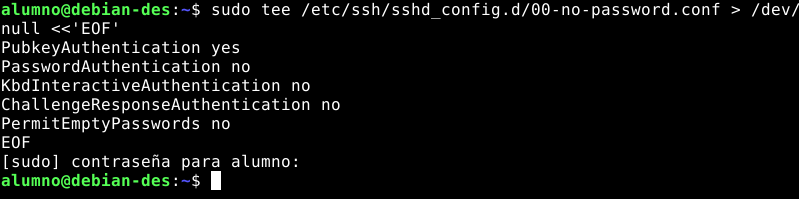
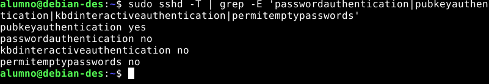
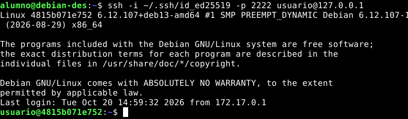
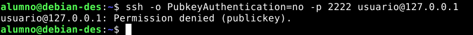
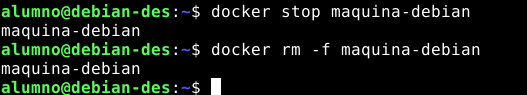
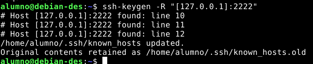

# Conectarse por SSH a una máquina Debian (desde cero)

Queremos entrar de forma remota en una máquina Debian desde otro equipo. Para eso hace falta que en esa máquina esté instalado y en marcha el servidor SSH (`sshd`). En esta guía lo hacemos desde cero sobre una máquina Debian que levantamos con Docker a modo de ejemplo.

Esta práctica también "vale para una VPS real". Los comandos dentro de la máquina son los mismos que en un servidor Debian real. Solo cambian dos cosas: cómo te conectas (aquí a `127.0.0.1`, puerto `2222`; en una VPS, a su IP, puerto `22`), y que el contenedor no tiene `systemd`, así que los servicios se manejan con `service` en lugar de `systemctl`.

---

## 1. La «máquina remota»: un contenedor Debian

Un contenedor de Docker es como una pequeña máquina Linux completa. Necesitamos Docker instalado (comprobamos con `docker -v`) y un cliente SSH.

```bash
docker run -d --name maquina-debian -p 2222:22 debian:trixie sleep infinity
```

| Parte | Significado |
|---|---|
| `-d` | Ejecutar en segundo plano |
| `--name maquina-debian` | Nombre para referirnos a ella |
| `-p 2222:22` | Publica el puerto 22 de la máquina en el 2222 de tu equipo |
| `debian:trixie` | Imagen oficial de Debian 13 |
| `sleep infinity` | Mantiene el contenedor encendido |

<br>


Entraremos en la consola de la máquina y comprobaremos cuál es:

```bash
docker exec -it maquina-debian bash
cat /etc/os-release
```
<br>


IMPORTANTE: Necesitamos un acceso rescate. Dejaremos esta terminal abierta. Es como tener acceso físico a la máquina: aunque el SSH falle, desde aquí siempre podremos arreglarlo.

---

## 2. Instalar y arrancar el servidor SSH

Dentro de la consola del contenedor:

```bash
apt update
apt install openssh-server sudo
```

Pulsaremos Enter cuando pregunte `Do you want to continue?`.


Arrancamos el servicio y comprobamos su estado:

```bash
service ssh start
service ssh status
```

Debe responder `sshd is running.`


IMPORTANTE: ¿Por qué hay que arrancarlo a mano? En una Debian normal el servicio arranca solo al instalarse. En el contenedor no hay `systemd` y Docker impide que `apt` arranque servicios, así que se hace manualmente.

| Acción | Máquina real (systemd) | Contenedor |
|---|---|---|
| Arrancar | `sudo systemctl start ssh` | `service ssh start` |
| Ver estado | `sudo systemctl status ssh` | `service ssh status` |
| Recargar configuración | `sudo systemctl reload ssh` | `service ssh reload` |

---

## 3. Crear un usuario

No nos conectaremos como `root`: Debian lo impide por defecto con contraseña y es más seguro usar un usuario normal.

```bash
adduser usuario
```

Pide una contraseña (dos veces) y algunos datos opcionales que dejaremos vacíos con Enter. Al final confirmamos con `Y`.


Le daremos permisos de administración:

```bash
adduser usuario sudo
```


---

## 4. Primera conexión (con contraseña)

Abriremos **otra terminal en el equipo** (dejamos la del contenedor abierta):

```bash
ssh -p 2222 usuario@127.0.0.1
```

La primera vez SSH pregunta si confíamos en la máquina: responderemos `yes`. Su huella se guarda en `~/.ssh/known_hosts`, y en las siguientes conexiones SSH la compara para avisarnos si alguien se hace pasar por ella. Después pedimos la contraseña del usuario:


Comprobamos dónde está y salimos:

```bash
whoami
hostname
exit
```


En una VPS real el comando sería `ssh usuario@IP_DE_LA_VPS` (sin `-p`, el puerto por defecto ya es el 22). Si no conecta, hay que revisar que el cortafuegos del proveedor permita el puerto 22.

---

## 5. Autenticación con clave pública

Las contraseñas se pueden adivinar o robar. La alternativa es un **par de claves**: la privada no sale nunca del equipo y la pública se copia a la máquina remota. Esto se hace en **nuestro equipo**, no en el contenedor.

### 5.1. Comprobar si ya tenemos una clave

```bash
ls -la ~/.ssh
```

Buscaremos `id_ed25519` (privada) e `id_ed25519.pub` (pública). Si ya existen, podemos reutilizarlas y saltar al apartado 5.3.


### 5.2. Crear el par de claves

Si no tenemos ninguna:

```bash
ssh-keygen -t ed25519 -C "tu_correo@ejemplo.com"
```

- `-t ed25519`: tipo de clave (moderno, corto y seguro).
- `-C`: comentario para identificarla (normalmente tu email). Opcional.

Nos hará tres preguntas: dónde guardarla (Enter para la ruta por defecto), una "passphrase" (opcional, pero recomendada) y repetirla. Se crean dos archivos en `~/.ssh`:

| Archivo | Qué es | ¿Se comparte? |
|---|---|---|
| `id_ed25519` | Clave **privada**. Secreta. | **Nunca** |
| `id_ed25519.pub` | Clave **pública**. Se copia al servidor. | Sí |

IMPORTANTE: Nunca hay que compartir la clave privada. Si la pegas por error en un chat, correo o repositorio, considérala comprometida: bórrala y genera un par nuevo.

SSH es estricto con los permisos. Si algo falla, ajústalos:

```bash
chmod 700 ~/.ssh
chmod 600 ~/.ssh/id_ed25519
chmod 644 ~/.ssh/id_ed25519.pub
```

### 5.3. Copiar la clave pública a la máquina

```bash
ssh-copy-id -i ~/.ssh/id_ed25519.pub -p 2222 usuario@127.0.0.1
```

Pedirá la contraseña por última vez. La clave pública acaba en `~/.ssh/authorized_keys` de la máquina.


### 5.4. Probar la clave

```bash
ssh -i ~/.ssh/id_ed25519 -p 2222 usuario@127.0.0.1
```

Esta vez no debe pedir contraseña.


El argumento `-i`, indica qué clave privada usar. Si está en la ruta por defecto podemos omitirlo.

---

## 6. Deshabilitar el acceso por contraseña

Ahora que la clave funciona, quitamos la entrada con contraseña. Este cambio se hace **en la máquina remota**.

IMPORTANTE: **No hay que cerrar la sesión SSH ni la consola**. Las mantendremos abiertas ambas hasta probarlo todo en otra terminal. Si algo sale mal, desde ellas podremos revertirlo.

### 6.1. Escribir la configuración

Creamos un archivo en `/etc/ssh/sshd_config.d/`, que Debian incluye automáticamente:

```bash
sudo tee /etc/ssh/sshd_config.d/00-no-password.conf > /dev/null <<'EOF'
PubkeyAuthentication yes
PasswordAuthentication no
KbdInteractiveAuthentication no
ChallengeResponseAuthentication no
PermitEmptyPasswords no
EOF
```



| Directiva | Qué hace |
|---|---|
| `PubkeyAuthentication yes` | Permite entrar con clave pública |
| `PasswordAuthentication no` | Desactiva la contraseña |
| `KbdInteractiveAuthentication no` | Desactiva la autenticación interactiva |
| `ChallengeResponseAuthentication no` | Nombre antiguo de la anterior (compatibilidad) |
| `PermitEmptyPasswords no` | Prohíbe cuentas sin contraseña |


IMPORTANTE: El nombre del archivo importa. Los archivos de `sshd_config.d` se leen en orden alfabético y gana el primero que define una opción. Con el prefijo `00-` nuestro archivo se impone a cualquier otro (muchas VPS traen un `50-cloud-init.conf` que puede reactivar la contraseña).

### 6.2. Validar y recargar

```bash
sudo sshd -t
sudo service ssh reload
```

Si `sshd -t` no muestra nada, no hay errores. Al recargar, el contenedor responde `Reloading OpenBSD Secure Shell server's configuration: sshd.` y las conexiones abiertas no se cortan.


### 6.3. Comprobar la configuración efectiva

```bash
sudo sshd -T | grep -E 'passwordauthentication|pubkeyauthentication|kbdinteractiveauthentication|permitemptypasswords'
```

Debe aparecer `passwordauthentication no` y `pubkeyauthentication yes`.



---

## 7. Probar la nueva conexión

Sin cerrar la sesión actual, abriremos otra terminal y entraremos con la clave:

```bash
ssh -i ~/.ssh/id_ed25519 -p 2222 usuario@127.0.0.1
```

Debe entrar directo, sin contraseña.



Ahora la prueba definitiva: forzar un intento con contraseña.

```bash
ssh -o PubkeyAuthentication=no -p 2222 usuario@127.0.0.1
```

Ejecútaremos desde el equipo, no desde el contenedor. Debe fallar con `Permission denied (publickey)`. Ese error es la buena noticia: la máquina ya solo acepta claves.



---

## 8. Apagar y borrar la máquina de ejemplo

```bash
docker stop maquina-debian
docker rm -f maquina-debian
```



Si queremos crearla de nuevo, borraremos la huella antigua (la máquina nueva tendrá claves de host nuevas):

```bash
ssh-keygen -R "[127.0.0.1]:2222"
```



---

## 9. Solución de problemas

| Problema | Qué hacer |
|---|---|
| `Connection refused` | El SSH no está arrancado o el puerto no está publicado. Dentro de la máquina: `service ssh status`. En el equipo: `docker port maquina-debian` |
| `REMOTE HOST IDENTIFICATION HAS CHANGED!` | Recreaste el contenedor. Ejecuta `ssh-keygen -R "[127.0.0.1]:2222"` |
| `Permission denied (publickey)` con la clave | La clave no está en `authorized_keys` o los permisos son incorrectos (`chmod 700 ~/.ssh` y `chmod 600 ~/.ssh/authorized_keys`). Usa `ssh -v` para ver qué claves prueba el cliente |
| La contraseña sigue funcionando | Revisa el orden de los archivos de `sshd_config.d` y comprueba con `sudo sshd -T \| grep passwordauthentication` |
| `sshd -t` muestra errores | Corrígelos antes de recargar: una errata puede dejar el servidor sin arrancar |
| El puerto 2222 está ocupado | Usa otro, por ejemplo `-p 2223:22`, y conecta con `-p 2223` |

---

<br>

**Enlace al repo:** https://github.com/Atthemyg/DPL-2DAM/tree/main/practica-ssh