# Conectarse por SSH a una máquina Debian (desde cero)

Queremos entrar de forma remota en una máquina Debian desde otro equipo. Para eso hace falta que en esa máquina esté instalado y en marcha el servidor SSH (`sshd`). En esta guía lo hacemos desde cero sobre una máquina Debian que levantamos con Docker a modo de ejemplo.

Esta práctica también "vale para una VPS real". Los comandos dentro de la máquina son los mismos que en un servidor Debian real. Solo cambian dos cosas: cómo te conectas (aquí a `127.0.0.1`, puerto `2222`; en una VPS, a su IP, puerto `22`), y que el contenedor no tiene `systemd`, así que los servicios se manejan con `service` en lugar de `systemctl`.

---

## 1. La «máquina remota»: un contenedor Debian

Un contenedor de Docker es como una pequeña máquina Linux completa. Necesitamos Docker instalado (comprobamos con `docker -v`) y un cliente SSH.

```bash
docker run -d --name maquina-debian -p 2222:22 debian:trixie sleep infinity
```

| Parte | Significado |
|---|---|
| `-d` | Ejecutar en segundo plano |
| `--name maquina-debian` | Nombre para referirnos a ella |
| `-p 2222:22` | Publica el puerto 22 de la máquina en el 2222 de tu equipo |
| `debian:trixie` | Imagen oficial de Debian 13 |
| `sleep infinity` | Mantiene el contenedor encendido |

<br>

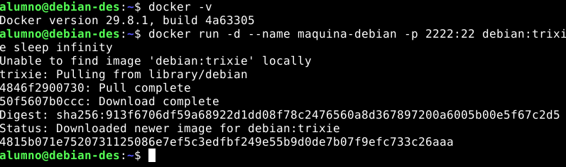

Entraremos en la consola de la máquina y comprobaremos cuál es:

```bash
docker exec -it maquina-debian bash
cat /etc/os-release
```
<br>

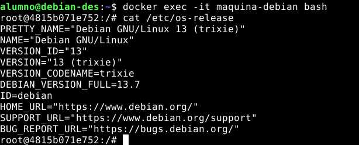

IMPORTANTE: Necesitamos un acceso rescate. Dejaremos esta terminal abierta. Es como tener acceso físico a la máquina: aunque el SSH falle, desde aquí siempre podremos arreglarlo.

---

## 2. Instalar y arrancar el servidor SSH

Dentro de la consola del contenedor:

```bash
apt update
apt install openssh-server sudo
```

Pulsaremos Enter cuando pregunte `Do you want to continue?`.

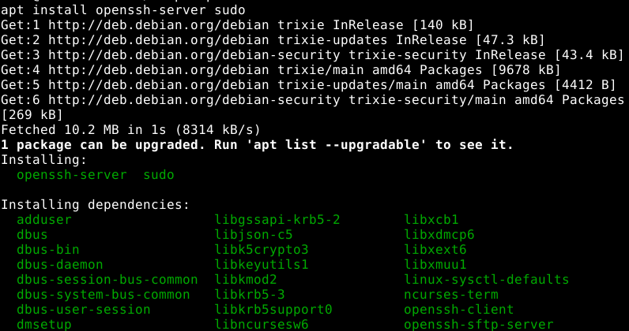

Arrancamos el servicio y comprobamos su estado:

```bash
service ssh start
service ssh status
```

Debe responder `sshd is running.`

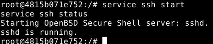

IMPORTANTE: ¿Por qué hay que arrancarlo a mano? En una Debian normal el servicio arranca solo al instalarse. En el contenedor no hay `systemd` y Docker impide que `apt` arranque servicios, así que se hace manualmente.

| Acción | Máquina real (systemd) | Contenedor |
|---|---|---|
| Arrancar | `sudo systemctl start ssh` | `service ssh start` |
| Ver estado | `sudo systemctl status ssh` | `service ssh status` |
| Recargar configuración | `sudo systemctl reload ssh` | `service ssh reload` |

---

## 3. Crear un usuario

No nos conectaremos como `root`: Debian lo impide por defecto con contraseña y es más seguro usar un usuario normal.

```bash
adduser usuario
```

Pide una contraseña (dos veces) y algunos datos opcionales que dejaremos vacíos con Enter. Al final confirmamos con `Y`.

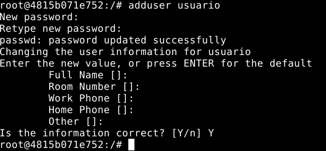

Le daremos permisos de administración:

```bash
adduser usuario sudo
```

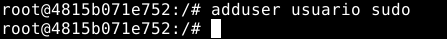

---

## 4. Primera conexión (con contraseña)

Abriremos **otra terminal en el equipo** (dejamos la del contenedor abierta):

```bash
ssh -p 2222 usuario@127.0.0.1
```

La primera vez SSH pregunta si confíamos en la máquina: responderemos `yes`. Su huella se guarda en `~/.ssh/known_hosts`, y en las siguientes conexiones SSH la compara para avisarnos si alguien se hace pasar por ella. Después pedimos la contraseña del usuario:

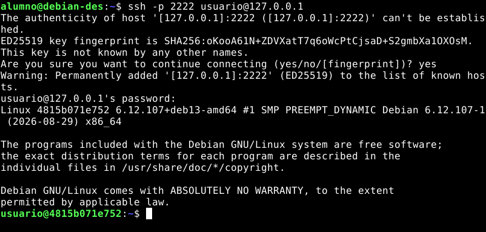

Comprobamos dónde está y salimos:

```bash
whoami
hostname
exit
```

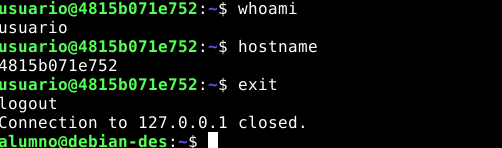

En una VPS real el comando sería `ssh usuario@IP_DE_LA_VPS` (sin `-p`, el puerto por defecto ya es el 22). Si no conecta, hay que revisar que el cortafuegos del proveedor permita el puerto 22.

---

## 5. Autenticación con clave pública

Las contraseñas se pueden adivinar o robar. La alternativa es un **par de claves**: la privada no sale nunca del equipo y la pública se copia a la máquina remota. Esto se hace en **nuestro equipo**, no en el contenedor.

### 5.1. Comprobar si ya tenemos una clave

```bash
ls -la ~/.ssh
```

Buscaremos `id_ed25519` (privada) e `id_ed25519.pub` (pública). Si ya existen, podemos reutilizarlas y saltar al apartado 5.3.

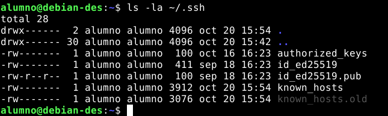

### 5.2. Crear el par de claves

Si no tenemos ninguna:

```bash
ssh-keygen -t ed25519 -C "tu_correo@ejemplo.com"
```

- `-t ed25519`: tipo de clave (moderno, corto y seguro).
- `-C`: comentario para identificarla (normalmente tu email). Opcional.

Nos hará tres preguntas: dónde guardarla (Enter para la ruta por defecto), una "passphrase" (opcional, pero recomendada) y repetirla. Se crean dos archivos en `~/.ssh`:

| Archivo | Qué es | ¿Se comparte? |
|---|---|---|
| `id_ed25519` | Clave **privada**. Secreta. | **Nunca** |
| `id_ed25519.pub` | Clave **pública**. Se copia al servidor. | Sí |

IMPORTANTE: Nunca hay que compartir la clave privada. Si la pegas por error en un chat, correo o repositorio, considérala comprometida: bórrala y genera un par nuevo.

SSH es estricto con los permisos. Si algo falla, ajústalos:

```bash
chmod 700 ~/.ssh
chmod 600 ~/.ssh/id_ed25519
chmod 644 ~/.ssh/id_ed25519.pub
```

### 5.3. Copiar la clave pública a la máquina

```bash
ssh-copy-id -i ~/.ssh/id_ed25519.pub -p 2222 usuario@127.0.0.1
```

Pedirá la contraseña por última vez. La clave pública acaba en `~/.ssh/authorized_keys` de la máquina.

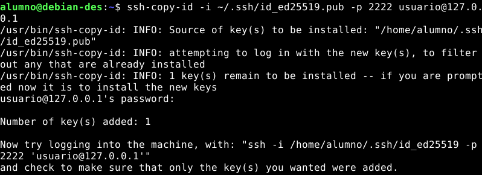

### 5.4. Probar la clave

```bash
ssh -i ~/.ssh/id_ed25519 -p 2222 usuario@127.0.0.1
```

Esta vez no debe pedir contraseña.

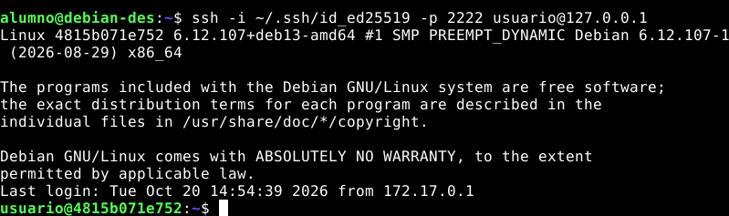

El argumento `-i`, indica qué clave privada usar. Si está en la ruta por defecto podemos omitirlo.

---